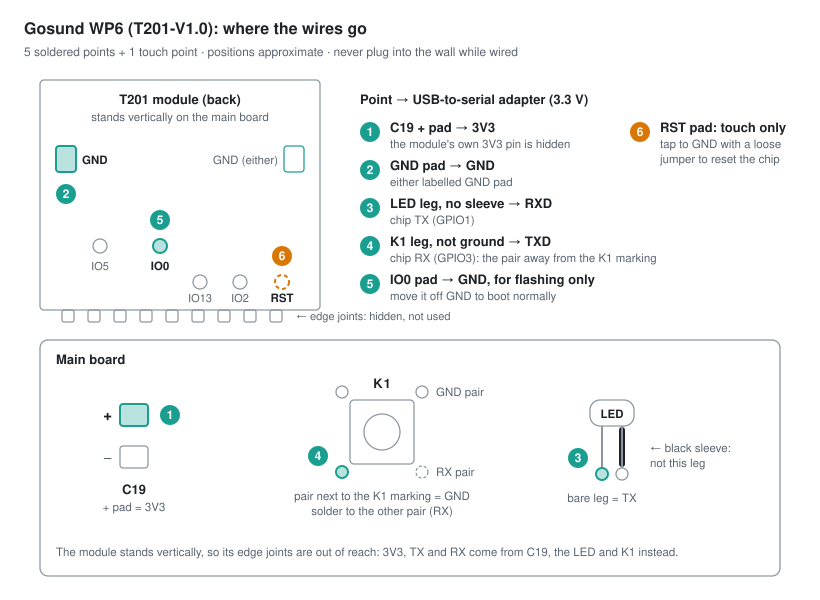
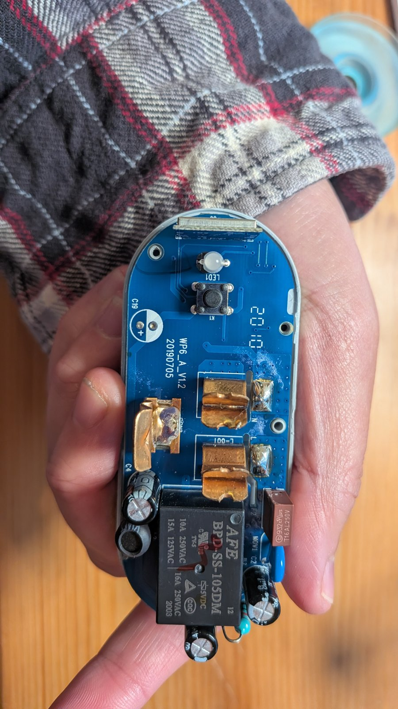
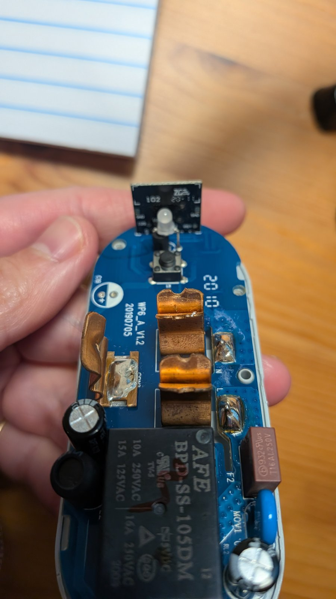
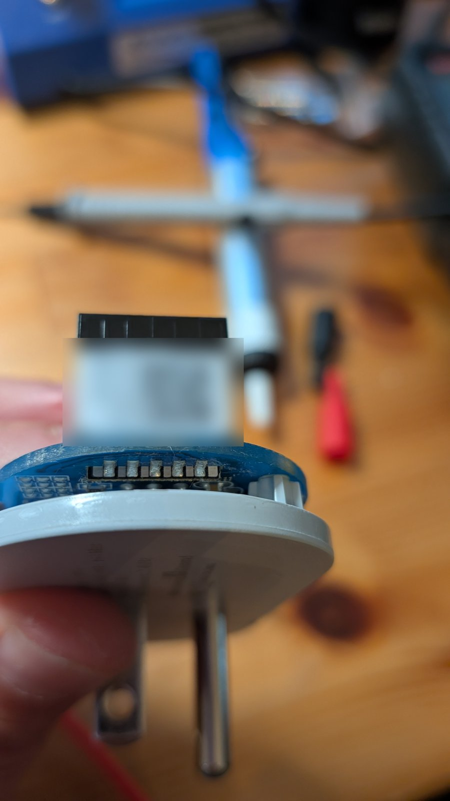
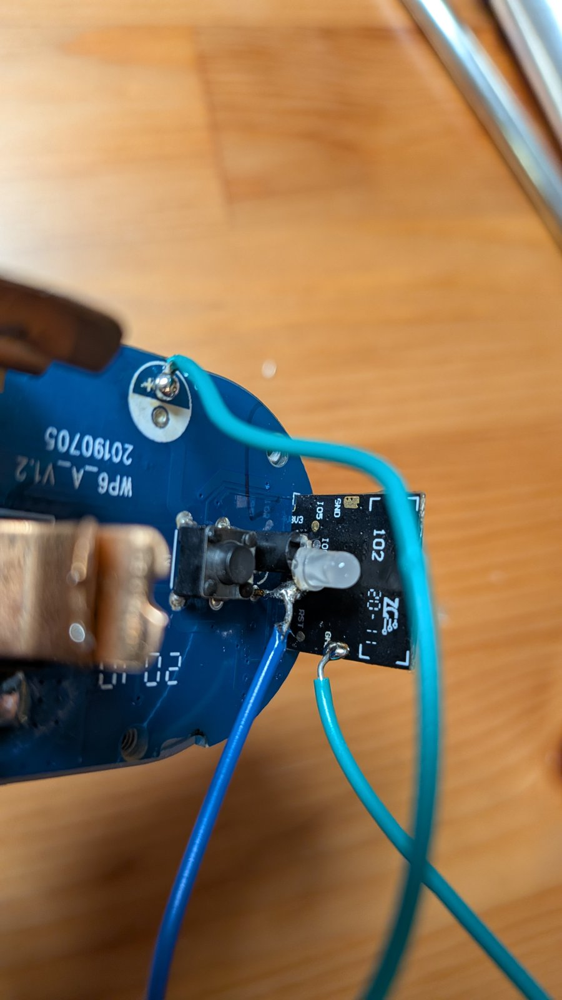
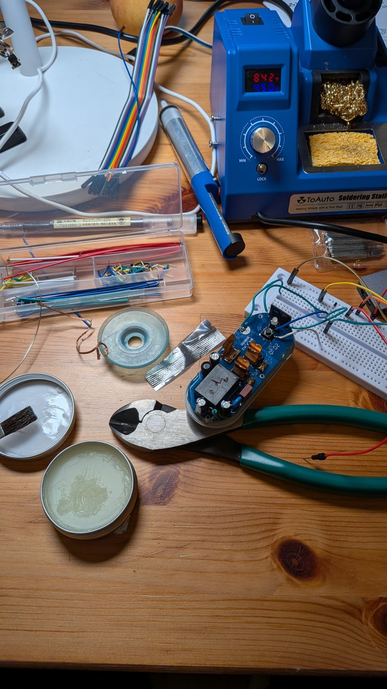

# wp6-esphome-reflash

Flashing ESPHome onto a **Gosund WP6** smart plug over serial, so Home Assistant
controls it locally with no Tuya cloud. This unit (T201-V1.0 module, ESP8285,
dated 11/2020) had patched firmware, so tuya-convert was not an option.

## What this unit actually uses

The pins differ from some published WP6/WP3 pages, so these were tested one by one:

| Function | Pin | How it was confirmed |
|---|---|---|
| Relay | GPIO14 | Relay clicks on mains when toggled over the API |
| Button | GPIO3 (RX), pressed = low | Each press toggles Power (`tools/watch_states.py`) |
| Red LED | GPIO13, on = low | Pin scan (`tools/led-test.yaml` + `tools/set_pin.py`) |
| Blue LED | none | GPIO1 lit nothing; this unit only ever shows red |

`wp6-lamp.yaml` uses the red LED to show the Power state. Serial logging is off
(`logger: baud_rate: 0`) because GPIO1/GPIO3 are the serial pins.

## Wiring for the first flash

Use a **3.3 V** USB-to-serial adapter. Never 5 V, and never plug the plug into the
wall while it is open or wired.



### Photos of this unit

<table>
  <tr>
    <td></td>
    <td></td>
    <td></td>
  </tr>
  <tr>
    <td><b>Main board</b> (WP6_A_V1.2, 2019-07-05). Top to bottom under the module: LED1 (point 3), K1 (point 4), and C19 on the left with its <b>+</b> marking (point 1).</td>
    <td><b>Module back.</b> The T201 stands vertically, right behind the LED and the button, so the labelled pads (GND, IO0, RST) face you.</td>
    <td><b>Module edge.</b> The joints at the module's base are the edge joints: too tight to reach, which is why 3V3, TX and RX come from the main board. Label blurred.</td>
  </tr>
  <tr>
    <td></td>
    <td></td>
    <td></td>
  </tr>
  <tr>
    <td><b>First three wires.</b> Teal on the C19 <b>+</b> pad (point 1), teal on the module's GND pad (point 2), blue on the bare LED leg (point 3). The RX and IO0 wires came later.</td>
    <td><b>The bench.</b> The open plug wired to the breadboard and the 3.3 V USB-to-serial adapter, with the soldering station, flux and wick.</td>
    <td></td>
  </tr>
</table>

| Plug point | Adapter pin |
|---|---|
| C19 `+` pad (main board) | 3V3 |
| GND pad (back of module) | GND |
| LED leg without the black sleeve (chip TX) | RXD |
| Leg of button K1 on the side *away* from the K1 marking (chip RX); the pair next to the marking is GND | TXD |
| IO0 pad (back of module) | GND, only for flashing |

The module's real 3V3 pin is hidden, which is why C19 `+` is used.

## Lessons from the bench

- **A USB replug misses the boot message**: macOS opens the port after it has passed.
  Keep USB plugged in, listen at 74880 baud (`tools/listen.py`), and reset the chip
  by tapping the RST pad to GND with a loose jumper.
- **Flashing mode check**: with IO0 on GND and a RST tap, the ROM prints
  `boot mode:(1,7)` (`tools/bootmode.py`). `boot mode:(3,x)` means normal boot.
- No DTR/RTS wires, so esptool always runs with `--before no-reset --after no-reset`.
- ESPHome needs Python 3.13 or older (3.15 fails to build `ruamel.yaml.clib`).
- This ESPHome version does not log button presses at the default level; watch
  states over the API instead.

## Steps

For the full procedure, from opening the plug to plugging it back in, see
**[docs/step-by-step.md](docs/step-by-step.md)**. The short version:

```sh
uv venv --python 3.13 .venv
uv pip install --python .venv/bin/python esphome esptool pyserial aioesphomeapi
cp secrets.example.yaml secrets.yaml   # then edit it

PORT=/dev/cu.usbserial-0001
# 1. IO0 on GND, tap RST, then back up the original firmware (twice, and compare)
.venv/bin/python -m esptool --port $PORT --before no-reset --after no-reset \
  read-flash 0 0x100000 backup/wp6-backup-1.bin
# 2. Build and write ESPHome
.venv/bin/esphome compile wp6-lamp.yaml
.venv/bin/python -m esptool --port $PORT --before no-reset --after no-reset \
  write-flash 0x0 .esphome/build/wp6-lamp/.pioenvs/wp6-lamp/firmware.bin
# 3. Move IO0 off GND, replug USB: the plug joins Wi-Fi. Later updates go over Wi-Fi:
.venv/bin/esphome run wp6-lamp.yaml
```

Keep the firmware backup out of git and somewhere besides the laptop: it can hold
your old Wi-Fi password and the Tuya device key.

## Tools

| Script | Purpose |
|---|---|
| `tools/listen.py PORT BAUD SECONDS` | Print everything on the serial port |
| `tools/capture.py PORT BAUD SECONDS` | Capture output right after a USB replug |
| `tools/bootmode.py PORT` | Wait for a reset and print the boot message |
| `tools/watch_states.py HOST SECONDS` | Print state changes over the ESPHome API |
| `tools/toggle_relay.py HOST DELAY` | Switch Power on/off 4 times |
| `tools/led_scan.py HOST DELAY` | Step through the test pins in `led-test.yaml` |
| `tools/set_pin.py HOST "T GPIO13" on\|off` | Hold one test pin high or low |
| `tools/led-test.yaml` | Temporary build that exposes candidate LED pins as switches |

## Sources

- [ESPHome devices: Gosund WP6](https://devices.esphome.io/devices/gosund-wp6/)
- [Blakadder: Gosund WP6](https://templates.blakadder.com/gosund_WP6.html)
- [equivariant: T201-V1.0 ESP8285 notes](https://equivariant.org/t201-v10-esp8285-arduino.html)
